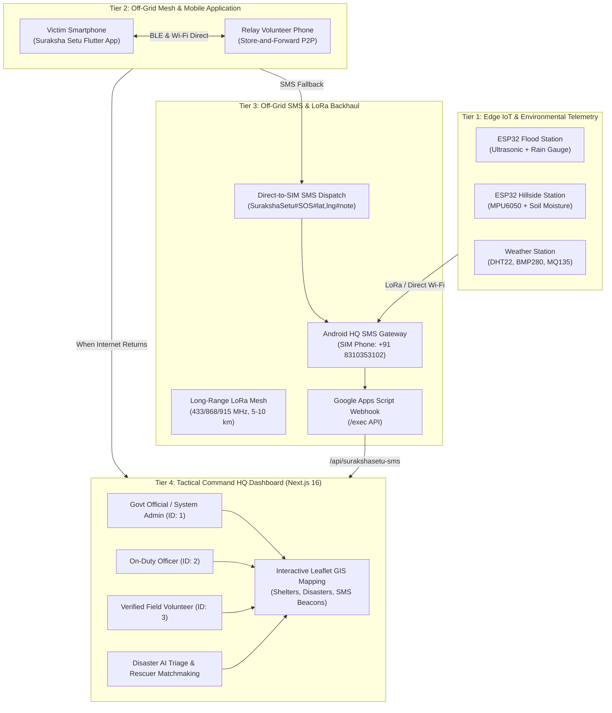

# 🛡️ Suraksha Setu (सुरक्षा सेतु): Comprehensive Project Blueprint & Architecture Overview

> **Low-Cost, Infrastructure-Independent Disaster Monitoring, Tactical Communication & Rescue Coordination Ecosystem**  
> *Recognized Winner at PES Hackathon & IEEE Region 10 Humanitarian Technology Activities (HTA) Makers DIY Project Competition Entry.*

---

## 📑 Table of Contents
1. [Executive Summary](#1-executive-summary)
2. [Unified 4-Tier System Architecture](#2-unified-4-tier-system-architecture)
3. [The 4 Core Pillars](#3-the-4-core-pillars)
   - [Pillar 1: Edge Threat & 12-Sensor IoT Network](#pillar-1-edge-threat--12-sensor-iot-network)
   - [Pillar 2: Offline Mobile P2P Mesh Tier (Flutter)](#pillar-2-offline-mobile-p2p-mesh-tier-flutter)
   - [Pillar 3: SurakshaSetu Off-Grid SMS Gateway](#pillar-3-surakshasetu-off-grid-sms-gateway)
   - [Pillar 4: Tactical Command & Control Web Platform](#pillar-4-tactical-command--control-web-platform)
4. [Role-Based Access Control & Credential Matrix](#4-role-based-access-control--credential-matrix)
5. [Repository & Directory Breakdown](#5-repository--directory-breakdown)
6. [API Route Reference](#6-api-route-reference)
7. [Local Setup, Development & Hardware Flashing Guide](#7-local-setup-development--hardware-flashing-guide)

---

## 1. Executive Summary

In acute natural and climate-driven disasters (e.g., flash floods, landslides, cyclones, earthquakes), conventional telecommunications—cellular towers, fiber optic backbones, and municipal power grids—frequently suffer total collapse within minutes.

This results in a **dual-blind crisis**:
1. Stranded victims cannot dispatch geo-referenced distress signals.
2. District Command & Emergency Operations Centers (EOC) cannot visualize flood inundation or landslide accelerations in real time.

**Suraksha Setu** bridges this gap through a modular, hardware-agnostic, and fully off-grid resilience stack combining:
- **Autonomous ESP32 Solar Sensing Nodes** (monitoring 12 environmental telemetry indicators).
- **Offline Smartphone P2P Mesh Networking** (BLE discovery + Wi-Fi Direct store-and-forward transfer).
- **Off-Grid SMS Gateway Integration** (direct device-to-SIM formatted distress dispatch).
- **Tactical Next.js 16 Web Command Center** with Machine Learning priority triage, volunteer onboarding verification, and dynamic rescuer routing.

---

## 2. Unified 4-Tier System Architecture



---

## 3. The 4 Core Pillars

### Pillar 1: Edge Threat & 12-Sensor IoT Network
The physical telemetry infrastructure deployed in disaster-prone sectors utilizes ESP32 microcontrollers operating with deep-sleep power cycles and solar harvesting:
* **Ultrasonic Distance Sensor (HC-SR04):** Measures river, dam, and canal water levels with millimetric accuracy.
* **Precipitation Sensor (Rain Gauge):** Real-time rainfall intensity and flash-flood thresholding.
* **Triple-Axis Accelerometer (MPU6050 / ADXL345):** Seismic vibration and hillside tectonic shift detection for landslide alerts.
* **Capacitive Soil Saturation Probe:** Detects ground liquefaction risks before mudslides trigger.
* **Atmospheric Sensors (DHT22, BMP280):** Ambient temperature, relative humidity, and barometric pressure for storm-front prediction.
* **Gas & Smoke Analysis (MQ135):** Wildfire and hazardous post-earthquake gas leak detection.
* **Wind Telemetry:** Anemometer and directional sensors for cyclone propagation forecasting.

### Pillar 2: Offline Mobile P2P Mesh Tier (Flutter)
The companion cross-platform mobile application located in `SurakshaSetu/`:
* **Zero Infrastructure Requirement:** Connects victim smartphones to nearby rescuer and node stations without cellular service.
* **BLE Proximity Discovery:** Discovers nearby victim beacons, local nodes, and battery levels.
* **Wi-Fi Direct Payload Transfers:** Exposes high-bandwidth transfer of encrypted medical incident cards, offline vector map tiles, and evacuation manifests.
* **Store-and-Forward Protocol:** Hops data from phone to phone until an internet-connected node or HQ relay is within range.

### Pillar 3: SurakshaSetu Off-Grid SMS Gateway
When both internet and local Wi-Fi mesh are unavailable, the system activates its direct cellular radio fallback:
* **Formatted Protocol:** Dispatches SMS alerts formatted strictly as:
  ```text
  SurakshaSetu#SOS#<latitude>,<longitude>#<emergency_note>
  ```
  *(Example: `SurakshaSetu#SOS#12.9716,77.5946#Critical medical supplies and evacuation needed`)*
* **Hardware Gateway Bridge:** An on-duty Android SIM node (`NEXT_PUBLIC_HQ_GATEWAY_PHONE`) receives incoming SMS messages and forwards them upstream via a Google Apps Script webhook.
* **Internal Proxy & Map Integration:** 
  - `src/app/api/surakshasetu-sms/route.js` acts as an edge caching proxy.
  - `src/components/SurakshaSetuSMSPanel.jsx` polls alerts every 5 seconds.
  - Alerts are rendered on `MapComponent.js` with distinct glowing amber beacons and clickable distress popups.

### Pillar 4: Tactical Command & Control Web Platform
The operations center built with **Next.js 16**, **React 19**, and **Turbopack**:
* **Real-Time GIS Tactical Map:** Dynamic rendering of Base Station depots, active disaster zones, emergency shelters, on-duty volunteer squads, and off-grid SMS distress points.
* **ML Priority Scoring Engine:** Calculates weighted incident severity scores taking into account resource type, casualty count, and urgency.
* **Smart Rescuer Matchmaking:** Computes Euclidean/Haversine proximity between active rescuers and unresolved casualty clusters.
* **HQ Emergency Broadcasts:** Transmits emergency bulletins across all operational sectors.
* **Volunteer Onboarding & Verification:** Document verification workflow (NCC/NSS certificates, Medical Council credentials, Civil Defense passes) with dedicated task assignment.

---

## 4. Role-Based Access Control & Credential Matrix

The web platform features 3 distinct authenticated operational profiles:

| Role | Username | Password | Access Scope & Capabilities |
| :--- | :---: | :---: | :--- |
| **Govt Official / System Admin** | `1` | `1` | Full tactical authority: Resource allocation, volunteer dispatch, AI triage triage overrides, telemetry sensor configuration, and HQ emergency broadcast dispatch. |
| **On-Duty Officer / Civilian User** | `2` | `2` | Interactive emergency submission: Coordinate pin placement, ML risk scoring, resource request filing, panic SOS button, and local shelter lookup. |
| **Field Volunteer** | `3` | `3` | Operational responder portal: Credential verification onboarding, active mission acceptance (`Accept Mission`), route navigation, and status toggles (`available` / `busy`). |

---

## 5. Repository & Directory Breakdown

```text
SSSE-Tumkur/
├── public/                               # Static distribution assets
│   ├── suraksha_setu_mobile_arm64.apk    # Production compiled mobile client APK
│   └── favicon.ico                       # Tactical dashboard icon
├── src/
│   ├── app/                              # Next.js App Router root
│   │   ├── api/                          # Backend API Microservices
│   │   │   ├── ai-summary/route.js       # Groq/AI incident situation summarizer
│   │   │   ├── ai-triage/route.js        # Automated triage classification
│   │   │   ├── broadcasts/route.js       # HQ emergency bulletin persistence
│   │   │   ├── config/route.js           # Runtime environment injector
│   │   │   ├── requests/route.js         # Emergency incident requests CRUD
│   │   │   ├── surakshasetu-sms/route.js # Off-grid SMS gateway webhook proxy
│   │   │   ├── telemetry/route.js        # ESP32 sensor ingestion endpoint
│   │   │   └── volunteers/route.js       # Field volunteer persistence & verification
│   │   ├── globals.css                   # Tactical command design system
│   │   ├── layout.js                     # Root HTML wrapper and metadata
│   │   ├── MapComponent.js               # Leaflet GIS interactive map engine
│   │   └── page.js                       # Unified Admin, User & Volunteer workstation
│   ├── components/
│   │   └── SurakshaSetuSMSPanel.jsx      # Off-grid SMS dispatcher & live feed table
│   └── data/                             # File-backed local JSON databases
│       ├── broadcasts.json               # Persisted broadcast alerts
│       ├── requests.json                 # Seeded and live incident requests
│       ├── telemetry.json                # Live 12-sensor hardware logs
│       └── volunteers.json               # Registered and verified field volunteers
├── SurakshaSetu/                         # Mobile Client Tier (Flutter & Dart)
│   ├── lib/
│   │   ├── models/sos.dart               # P2P packet serialization models
│   │   ├── screens/                      # Victim, Command, Map & Relay screens
│   │   └── services/                     # Storage, Wi-Fi Direct, and sync bridges
│   └── pubspec.yaml                      # Mobile dependencies
├── hardware/                             # Firmware & IoT Tier
│   ├── espcode.c++                       # Master ESP32 LoRa & 12-sensor firmware
│   ├── hackathon_demo_firmware.ino       # Plug-and-play Arduino test firmware
│   └── system_architecture.md            # Hardware wiring & pinout diagrams
├── .env.example                          # Environment configuration template
├── .env.local                            # Local secrets (webhook URLs, SIM numbers)
├── package.json                          # Node dependencies (Next.js 16, React 19)
└── PROJECT_OVERVIEW.md                   # This master documentation document
```

---

## 6. API Route Reference

| Endpoint | Method | Description |
| :--- | :---: | :--- |
| `/api/surakshasetu-sms` | `GET` | Fetches live incoming SMS messages from the Google Apps Script webhook proxy (`{ cache: 'no-store' }`). |
| `/api/requests` | `GET` / `POST` | Fetches active and resolved incident tickets or submits new emergency distress signals. |
| `/api/volunteers` | `GET` / `POST` | Retrieves on-duty volunteer squads or registers newly onboarded field responders with document credentials. |
| `/api/telemetry` | `GET` / `POST` | Ingestion and polling endpoint for real-time ESP32 12-sensor hardware telemetry. |
| `/api/broadcasts` | `GET` / `POST` | Dispatches high-priority evacuation orders and public service announcements. |
| `/api/ai-triage` | `POST` | Processes incident descriptions via AI for urgency validation and rescuer matchmaking. |
| `/api/config` | `GET` | Returns sanitized frontend configurations (Supabase endpoints, public keys). |

---

## 7. Local Setup, Development & Hardware Flashing Guide

### Prerequisites
* **Node.js:** v18+ (tested on Node v24.x)
* **npm:** v9+
* **C++ / Arduino IDE:** For hardware module flashing (optional)
* **Flutter SDK:** For mobile client compilation (optional)

### Step 1: Environment Variables Setup
Copy the template configuration:
```bash
cp .env.example .env.local
```
Ensure `.env.local` contains:
```env
NEXT_PUBLIC_SURAKSHASETU_WEBHOOK_URL=https://script.google.com/macros/s/<DEPLOYMENT_ID>/exec
NEXT_PUBLIC_HQ_GATEWAY_PHONE=+918310353102
```

### Step 2: Install Dependencies & Run Next.js Server
```bash
# Install node packages
npm install

# Start development server with Turbopack
npm run dev
```
Open **[http://localhost:3000](http://localhost:3000)** in your browser.

### Step 3: Hardware Firmware Flashing
1. Connect the ESP32 development board via micro-USB.
2. Open `hardware/hackathon_demo_firmware/hackathon_demo_firmware.ino` or `hardware/espcode.c++` in Arduino IDE.
3. Configure the destination laptop IP address:
   ```c++
   const char* local_dashboard_url = "http://<YOUR_LAPTOP_IP>:3000/api/telemetry";
   ```
4. Flash the board (`Baud rate: 115200`). Live telemetry will immediately appear on the command dashboard.
